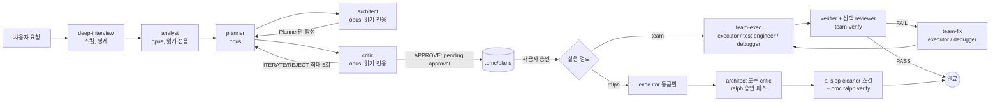

# OMC 에이전트(subagent) 운용 권장 사항 조사

- 대상: 로컬 설치본 `oh-my-claudecode` v5.7.5. 이하 `$OMC` = `~/.claude/plugins/cache/omc/oh-my-claudecode/5.7.5`. 파이프라인·상태 전이·트리거·확장점 일반론은 [omc-usage.md](./omc-usage.md)를 참조하고 여기서는 반복하지 않는다.
- 요약 1: OMC는 "계획 → 실행 → 검증"을 서로 다른 에이전트가 맡도록 짠다. 작성자의 자기 승인 금지는 `CLAUDE.md`, `verifier`, `code-reviewer`, `writer`, `review` skill에 명문화돼 있다.
- 요약 2: 19개 에이전트 중 9개(analyst, architect, code-reviewer, critic, document-specialist, explore, scientist, security-reviewer, verifier)만 `disallowedTools: Write, Edit`로 읽기 전용이다. planner는 도구 제한이 없고 "코드를 쓰지 말라"는 프롬프트 규칙뿐이다.
- 요약 3: 모델 등급은 에이전트 frontmatter가 기준이다. 문서 여러 곳(REFERENCE, agent-tiers 등)이 frontmatter와 어긋나므로 문서가 아니라 `agents/*.md`를 믿어야 한다.
- 요약 4: "테스트 작성자(`test-engineer`)와 구현자(`executor`)를 분리"하는 구성은 역할 정의상 가능하다. 그러나 OMC에는 이를 강제하는 코드도, 두 에이전트를 이 순서로 묶은 정본 워크플로도 없다(Codex용 템플릿의 `Anti-Slop Cleanup` 조합이 유일한 선례).
- 요약 5: 서브에이전트 보고를 검증하는 방법은 "검증자가 명령을 직접 다시 실행"하는 프롬프트 규칙이 전부다. 자동 검증 hook은 조언 수준이다.

표기: 근거는 `경로:줄번호`(상대경로는 `$OMC` 기준). 출처 유형은 [문서] OMC 문서·skill 본문, [프롬프트] 에이전트 프롬프트에서 읽어낸 것, [공식] Claude Code 공식 문서, [추론] 본인 해석. 근거 없음은 "확인 불가".

---

## 1. 에이전트 카탈로그

### 1.1 표 (frontmatter 기준)

도구 권한 열의 "읽기 전용"은 frontmatter `disallowedTools: Write, Edit` 존재 여부다(각 파일 6행). `Bash`는 막혀 있지 않으므로 읽기 전용 에이전트도 셸로 파일을 쓸 수는 있다[추론].

| 에이전트 | 역할 | 모델 | 도구 권한 | 쓰지 말아야 할 때 [프롬프트의 "not responsible for"] | 근거 |
| --- | --- | --- | --- | --- | --- |
| `explore` | 파일·심볼 위치 탐색 | haiku | 읽기 전용 | 코드 수정, 외부 문서 검색(→document-specialist) | `agents/explore.md:4,6,12,33` |
| `analyst` | 기획 전 요구사항 갭, 수락 기준 | opus | 읽기 전용 | 시장 가치 판단, 코드 분석, 계획 작성 | `agents/analyst.md:4,6,12,30` |
| `planner` | 인터뷰 후 작업 계획을 `.omc/plans/*.md`에 저장 | opus | 제한 없음(프롬프트로만 코드 작성 금지) | 구현, 사용자가 요청하기 전 계획 생성 | `agents/planner.md:4,31-33` |
| `architect` | 코드 분석, 디버깅 자문, 구현 검증 | opus | 읽기 전용 | 요구사항 수집, 계획 작성, 구현 | `agents/architect.md:4,6,12,30` |
| `critic` | 계획·코드의 최종 품질 게이트 | opus | 읽기 전용 | 칭찬성 리뷰, 없는 문제 만들기 | `agents/critic.md:4,6,46-52` |
| `executor` | 지정된 변경 구현 | sonnet | 전체 | 아키텍처 결정, 계획, 근본 원인 디버깅, 품질 리뷰 | `agents/executor.md:4,12` |
| `debugger` | 근본 원인 분석, 빌드·타입 오류 복구 | sonnet | 전체 | 아키텍처 설계, 기능 구현, 리팩터링 | `agents/debugger.md:4,12` |
| `test-engineer` | 테스트 전략·작성, flaky 보강, TDD 지도 | sonnet | 전체 | 기능 구현(→executor), 보안 테스트 | `agents/test-engineer.md:4,12,29` |
| `verifier` | 완료 주장에 대한 신선한 증거 검사 | sonnet | 읽기 전용(Bash 가능) | 기능 작성, 스타일 리뷰, 보안 감사 | `agents/verifier.md:4,6,13,45` |
| `code-reviewer` | 심각도 등급 코드 리뷰(스펙 준수 → 품질) | opus | 읽기 전용 | 수정 구현, 아키텍처 설계, 테스트 작성 | `agents/code-reviewer.md:4,6,12,37-39` |
| `security-reviewer` | OWASP·비밀 노출 탐지 | opus | 읽기 전용 | 스타일, 논리 정확성, 수정 구현 | `agents/security-reviewer.md:4,6,12` |
| `code-simplifier` | 동작 보존 단순화 | opus | 전체 | 동작 변경, 기능·테스트·문서 추가 | `agents/code-simplifier.md:4,61-62` |
| `tracer` | 경쟁 가설 기반 인과 추적 | sonnet | 전체 | 구현으로 기본 전환, 일반 리뷰 | `agents/tracer.md:4,12,39` |
| `designer` | UI/UX 구현 | sonnet | 전체 | 백엔드, API 설계, 리서치 증거 생성 | `agents/designer.md:4,12` |
| `document-specialist` | 외부 문서·SDK·논문 조사 | sonnet | 읽기 전용 | 저장소 내부 코드 탐색(→explore), 구현 | `agents/document-specialist.md:4,6,12,25` |
| `qa-tester` | tmux 기반 CLI·서비스 런타임 검증 | sonnet | 전체 | 기능 구현, 버그 수정, 단위 테스트 작성 | `agents/qa-tester.md:4,12,28` |
| `scientist` | 샌드박스 python_repl 데이터 분석 | sonnet | 읽기 전용 | 기능 구현, 코드 리뷰, 외부 조사 | `agents/scientist.md:4,6,12,29-35` |
| `git-master` | 원자적 커밋, 리베이스, 이력 | sonnet | 전체 | 구현, 리뷰, 테스트 | `agents/git-master.md:4,12,30` |
| `writer` | README·API 문서·주석 | haiku | 전체 | 구현, 리뷰, 자기 승인 | `agents/writer.md:4,12,32-33` |

제약 있는 에이전트 보강
- `executor`·`git-master`·`code-simplifier`·`scientist`는 하위 에이전트를 스폰하지 않고 단독 작업한다. 단 `executor`는 읽기 전용 `explore`(최대 3)와 `architect` 자문은 허용된다 (`agents/executor.md:33`; `agents/git-master.md:30`; `agents/code-simplifier.md:60`; `agents/scientist.md:35`).
- 실제 에이전트 파일은 19개이고 `vision`은 없다. 문서의 `vision` 행은 낡았으며 코드상 `document-specialist`의 별칭이다 (`src/features/delegation-routing/types.ts:71`; `docs/REFERENCE.md:820`).
- 읽기 전용 강제의 출처: frontmatter `disallowedTools`는 Claude Code가 해석하는 필드다 [공식: https://code.claude.com/docs/en/sub-agents]. `docs/HOOKS.md:129`는 pre-tool-enforcer가 "읽기 전용 에이전트의 Write/Edit를 막는다"고 쓰지만, `scripts/pre-tool-enforcer.mjs`에서 그런 로직은 찾지 못했다(확인 불가).

### 1.2 문서 간 모델 등급 불일치

| 에이전트 | frontmatter (정본으로 채택) | 다른 문서의 값 | 근거 |
| --- | --- | --- | --- |
| `architect` | opus | REFERENCE는 기본 sonnet, `docs/shared/agent-tiers.md`는 "sonnet, opus" | `agents/architect.md:4`; `docs/REFERENCE.md:814`; `docs/shared/agent-tiers.md:9` |
| `code-reviewer` | opus | REFERENCE 표 한 곳은 sonnet, 다른 곳은 opus | `agents/code-reviewer.md:4`; `docs/REFERENCE.md:829`, `:862` |
| `security-reviewer` | opus | sonnet | `agents/security-reviewer.md:4`; `docs/REFERENCE.md:826` |
| `code-simplifier` | opus | agent-tiers는 sonnet | `agents/code-simplifier.md:4`; `docs/shared/agent-tiers.md:25` |
| ralph 기본 승인자 | `architect` | ARCHITECTURE는 `verifier`가 확인한다고 기술 | `skills/ralph/SKILL.md:57`; `docs/ARCHITECTURE.md:243` |

공식 GitHub `main`의 `docs/shared/agent-tiers.md`는 로컬과 같은 표였다(위 `vision`, `architect: sonnet, opus` 포함). 다른 문서는 GitHub와 대조하지 않았다.

---

## 2. 위임 원칙

### 2.1 직접 vs 위임

| 항목 | 규칙 | 출처 | 근거 |
| --- | --- | --- | --- |
| 위임 대상 | 다중 파일 변경, 리팩터링, 디버깅, 리뷰, 계획, 조사, 검증 | [문서] | `CLAUDE.md:17`; `docs/ARCHITECTURE.md:132-137` |
| 직접 수행 | 사소한 작업, 짧은 질의, 단일 명령 | [문서] | `CLAUDE.md:18` |
| 오케스트레이터 직접 쓰기 허용 | `~/.claude/**`, `.omc/**`, `.claude/**`, `CLAUDE.md`, `AGENTS.md` | [문서] | `CLAUDE.md:25` |
| 규모에 맞는 장치 | 단일 단위는 직접 구현, 독립 단위 여럿은 `executor` 병렬, 조율이 필요하면 `team`. "한 번의 집중 작업으로 끝날 일에 조율 장치를 띄우지 말 것" | [문서] | `skills/execute/SKILL.md:23-30` |
| team 회피 조건 | "한 사람이 더 빨리 끝낼 수 있을 때" | [문서] | `docs/shared/mode-selection-guide.md:56` |
| 넓은 요청 | explore 먼저, 그다음 계획 | [문서] | `CLAUDE.md:49`; `AGENTS.md:305` |
| 코드베이스 사실 | 사용자에게 묻지 말고 explore로 조회 | [프롬프트][문서] | `agents/planner.md:35`; `skills/plan/SKILL.md:64` |
| 계획 승인 후 | 계획 에이전트가 직접 구현 금지, `team` 또는 `ralph`로 이관 | [문서] | `skills/ralplan/SKILL.md:65`; `skills/plan/SKILL.md:130-131` |

### 2.2 에이전트 선택 기준

- 정본 표는 "도메인 → 에이전트 → 권장 모델" (`docs/shared/agent-tiers.md:5-64`, `docs/REFERENCE.md:834-868`). 단 1.2절의 불일치가 있다.
- 스킬과 에이전트 이름이 같으면 혼동된다. `Task(subagent_type="oh-my-claudecode:ai-slop-cleaner")`처럼 skill 이름을 에이전트로 부르면 PreToolUse hook이 거부하고 `Skill` 도구 식별자를 알려준다. 가장 비슷한 에이전트로 대체하지 말라고 명시한다 (`scripts/pre-tool-enforcer.mjs:391-418`; `skills/ralph/SKILL.md:199`).
- 호출 접두어는 항상 `oh-my-claudecode:` (`docs/REFERENCE.md:808`).

### 2.3 모델 등급 선택 기준

| 규칙 | 출처 | 근거 |
| --- | --- | --- |
| haiku=조회, sonnet=표준, opus=아키텍처·심층 분석, fable=opus 위 | [문서] | `CLAUDE.md:23` |
| 세션 모델(`/model`)은 메인 루프만 지배. 위임된 에이전트는 고정 등급 또는 명시한 `model` 인자 또는 `agents.<name>.model` 설정을 따른다 | [문서] | `CLAUDE.md:24` |
| 복잡한 코드는 `executor`에 `model=opus` | [문서] | `CLAUDE.md:19` |
| 위임 때 `model`을 항상 명시 (ralph) | [문서] | `skills/ralph/SKILL.md:110` |
| 검증 등급: LIGHT(<5파일·<100줄·완전 커버=haiku), STANDARD(기본=sonnet), THOROUGH(>20파일·보안·아키텍처=opus). 보안/설정 경로 패턴이면 무조건 THOROUGH | [문서] | `docs/shared/verification-tiers.md:7-24,36-62` |
| 상대 비용 1x/5x/20x와 "약 40% 절감" 수치. 산출 근거는 문서에 없음 | [문서] | `docs/shared/verification-tiers.md:77-83` (근거 확인 불가) |
| team의 비용 모드: opus→sonnet, sonnet→haiku로 낮추되 `team-verify`는 최소 sonnet | [문서] | `skills/team/SKILL.md:117` |
| model 인자 해소 순서(공식): 호출별 `model` > frontmatter > `CLAUDE_CODE_SUBAGENT_MODEL` > 메인 모델 | [공식] | https://code.claude.com/docs/en/sub-agents |
| OMC hook은 `model` 인자가 없으면 `agents.<name>.model` 설정값을 주입 | [문서] | `scripts/pre-tool-enforcer.mjs:1936-1949` |
| 위임 자동 모델 주입 문서는 있으나 낡은 서술 포함(예: `architect` opus 표) | [문서] | `docs/DELEGATION-ENFORCER.md:133-151` |

주의: `docs/agents/model-compatibility.md`는 Prometheus·Sisyphus 등 다른 하네스(OMO)의 에이전트명으로 쓰인 문서라 OMC 에이전트에는 해당하지 않는다 (`docs/agents/model-compatibility.md:10-18`).

### 2.4 병렬·직렬·백그라운드

| 규칙 | 출처 | 근거 |
| --- | --- | --- |
| 독립 작업 2개 이상이면 병렬. 독립 호출을 순차로 기다리는 것은 안티패턴 | [문서] | `CLAUDE.md:49`; `skills/ralph/SKILL.md:108`, `:253-262` |
| 각각 30초 넘는 독립 작업 2개 이상이면 병렬, 의존 작업은 직렬 | [문서] (Codex용 템플릿) | `AGENTS.md:308-309` |
| 설치·빌드·테스트는 `run_in_background: true`. 상태 확인·파일 읽기/편집·단순 명령은 포그라운드 | [문서] | `skills/ralph/SKILL.md:332-343`; `CLAUDE.md:49` |
| 동시 자식 수: 템플릿은 6개, Claude Code 기본 상한은 20 | [문서][공식] | `AGENTS.md:54`; `skills/team/SKILL.md:908` |
| 단계 간 직렬: autopilot 각 단계는 완료 후 다음으로, 병렬은 Phase 2·4 내부만 | [문서] | `skills/autopilot/SKILL.md:32-33` |
| ralplan: Architect와 Critic은 같은 고정 계획 스냅샷을 각자 검토. 둘 다 Claude면 병렬 가능, 외부 공급자가 끼면 반드시 직렬. Architect 결과를 Critic에 넘기지 않음 | [문서] | `skills/ralplan/SKILL.md:52-55` |
| 팀 워커 스폰은 모두 병렬 | [문서] | `skills/team/SKILL.md:369` |
| 팀 owner는 리드가 사전 배정(원자적 claim 없음) | [문서] | `skills/team/SKILL.md:332`, `:1028` |
| 컨텍스트 사용률이 임계(기본 72%) 이상이면 `Task` 등 에이전트 호출을 차단 | [문서] | `scripts/lib/pre-tool-enforcer-preflight.mjs:3-4,52-64` |

내부 모순: `skills/ralplan/SKILL.md:52`는 "Architect 완료를 기다린 뒤 4단계"라고 쓰고, 같은 파일 `:55`는 병렬 허용이라고 쓴다. 후자가 더 구체적이라 우선으로 읽는 것이 자연스럽다[추론].

### 2.5 위임 프롬프트에 담을 것

| 요소 | 출처 | 근거 |
| --- | --- | --- |
| TASK / EXPECTED OUTCOME / CONTEXT / MUST DO / MUST NOT DO / REQUIRED SKILLS / REQUIRED TOOLS / VERIFICATION CHECKLIST 8개 섹션 템플릿 | [문서] | `docs/FEATURES.md:269-301`; `src/agents/templates/implementation-template.md` |
| 구체 파일·패턴·기존 유틸을 컨텍스트로 | [문서] | `AGENTS.md:27` |
| 구체적 수락 기준 (PRD의 일반적 기준은 "PRD theater") | [문서] | `skills/ralph/SKILL.md:120`, `:265-268` |
| 팀 워커 프롬프트 = 프리앰블 + 배정 작업 + 이전 단계 핸드오프. 워커는 하위 에이전트 스폰 금지, 절대 경로 사용, 리드에 보고 | [문서] | `skills/team/SKILL.md:177`, `:447-491` |
| 핸드오프 문서 형식: Decided / Rejected / Risks / Files / Remaining, 10-20줄 | [문서] | `skills/team/SKILL.md:159-181` |
| 서브에이전트 브리프는 한 축에 집중, 약 400단어 이내 (review skill) | [문서] | `skills/review/SKILL.md:38` |
| 핸드오프는 내용이 아니라 포인터를 전달 | [문서] | `skills/launch/SKILL.md:179` |
| 프롬프트에 비밀 금지 (로그·상태에 남을 수 있음) | [문서] | `skills/team/SKILL.md:1036` |
| 서브에이전트는 대화 이력을 상속하지 않는다 | [공식] | https://code.claude.com/docs/en/sub-agents |

---

## 3. 역할 분리 패턴

### 3.1 작성자와 검증자 분리 규칙

| 규칙 | 출처 | 근거 |
| --- | --- | --- |
| 작성과 리뷰는 별도 패스. "같은 활성 컨텍스트에서 자기 승인 금지", 승인 패스는 `code-reviewer` 또는 `verifier` | [문서] | `CLAUDE.md:50-51` |
| `execute`: 작성과 승인은 별도 패스, `review`/`verify`로 넘긴다 | [문서] | `skills/execute/SKILL.md:40` |
| `review`: 리뷰어는 작성자와 같은 활성 컨텍스트이면 안 되고, 리뷰는 변경을 쓰지 않는다 | [문서] | `skills/review/SKILL.md:8`, `:41` |
| `verifier`: 같은 컨텍스트에서 만든 작업을 승인하지 않고, 명령을 직접 재실행 | [프롬프트] | `agents/verifier.md:30-33` |
| `code-reviewer`: CRITICAL/HIGH를 높은 확신으로 가진 코드는 승인 불가 | [프롬프트] | `agents/code-reviewer.md:38-40` |
| `writer`: 작성 패스만 수행, 리뷰·승인 요청은 별도 패스로 넘긴다 | [프롬프트] | `agents/writer.md:32-33` |
| `ai-slop-cleaner`: 고영향 정리는 writer 패스와 reviewer 패스 분리, 같은 패스의 작성+승인 금지 | [문서] | `skills/ai-slop-cleaner/SKILL.md:60-64,75-76`; `AGENTS.md:317-318` |
| `launch`: 리뷰어는 판정만 하고 수리하지 않으며, 수리는 단일 수리 워커가, 구현자는 자기 승인 금지. 2축 리뷰(표준·스펙) 보고 | [문서] (opt-in 스킬) | `skills/launch/SKILL.md:128-137` |
| ralplan: Planner 초안 → Architect 검토 → Critic 평가, Planner만 두 결과를 합성 | [문서] | `skills/ralplan/SKILL.md:52-58` |
| `/goal` 평가자는 대화에 드러난 증거만 판단. OMC 최종 게이트가 아님 | [문서] | `docs/shared/mode-selection-guide.md:63-74` |

### 3.2 모드별 에이전트 구성

| 모드/스킬 | 계획 | 실행 | 검증·리뷰 | 근거 |
| --- | --- | --- | --- | --- |
| `ralplan` / `plan --consensus` | `planner`(opus), 보조 `analyst`, `explore`(haiku) | 실행 안 함 (team/ralph로 이관) | `architect` → `critic` (최대 5회) | `skills/plan/SKILL.md:40,66,105-106,162`; `skills/ralplan/SKILL.md:45-65` |
| `autopilot` | Phase 0 `analyst`+`architect`, Phase 1 `architect`(계획)+`critic`(검증). ralplan 계획이 있으면 건너뜀 | Phase 2 `executor` haiku/sonnet/opus 병렬 | Phase 3 QA는 에이전트 지정 없음(빌드·린트·테스트·수정), Phase 4 `architect`+`security-reviewer`+`code-reviewer` 병렬, 전원 승인 | `skills/autopilot/SKILL.md:85-113,124-126` |
| `ralph` | (PRD를 리드가 정제) | `executor` 등급별 | 기본 `architect`(sonnet/opus), `--critic=critic`, `--critic=codex`. 승인 후 `ai-slop-cleaner` skill, `omc ralph verify` 재실행 | `skills/ralph/SKILL.md:57,133-136,156-180,193-197` |
| `team` | `explore`+`planner`, 선택 `analyst`·`architect` | `executor`(sonnet) 기본, `debugger`·`designer`·`writer`·`test-engineer` 선택 | `verifier` 필수 + `test-engineer`·`security-reviewer`·`code-reviewer`, 실패 시 `executor`/`debugger`가 fix | `skills/team/SKILL.md:105-111` |
| `launch` (opt-in) | explore 스카우트, 승인된 시임 목록(C2) | 팀 워커/`executor`가 tdd 규율로 구현 | 2축 리뷰 게이트, 수리 워커 | `skills/launch/SKILL.md:124-134` |
| 기능 개발 템플릿 | `analyst`→`planner` | `executor` | `test-engineer`→`code-reviewer`→`verifier` | `AGENTS.md:233-234` (Codex용 템플릿, 3.4절 주의) |
| Anti-Slop 정리 템플릿 | `planner` | `test-engineer`(먼저) → `executor` | `code-reviewer`→`verifier` | `AGENTS.md:236-237` |
| 버그 조사 템플릿 | `explore`+`debugger` | `executor` | `test-engineer`+`verifier` | `AGENTS.md:239-240` |

### 3.3 핸드오프 도표

근거: 위 3.2절 표의 각 행. 핸드오프 문서는 `.omc/handoffs/<stage>.md`에 기록된다 (`skills/team/SKILL.md:159-161`).

### 3.4 해석 주의

- 루트 `AGENTS.md`는 Codex용 템플릿이다(`spawn_agent`, `~/.codex/prompts/{role}.md` 사용: `AGENTS.md:63-91`). 존재하지 않는 `style-reviewer`, `api-reviewer`, `dependency-expert` 등도 나열한다(`AGENTS.md:129-133,137-138`). Claude Code 세션에 주입되는 쪽은 `CLAUDE.md`다. 따라서 `AGENTS.md:233-240`의 조합표는 "OMC가 구상하는 순서"의 참고일 뿐 Claude Code 쪽 정본 워크플로가 아니다[추론].
- `autopilot` Phase 1은 `architect`에게 계획 작성을 맡기는데(`skills/autopilot/SKILL.md:94`), `architect` 프롬프트는 계획 작성을 자기 책임이 아니라고 적는다(`agents/architect.md:12`). 문서·프롬프트 간 불일치다.
- `planner`가 인계하라고 지목한 `/oh-my-claudecode:start-work`는 skill 목록에서 찾지 못했다(`agents/planner.md:33`; 확인 불가).

---

## 4. 안티패턴과 한계

### 4.1 문서·프롬프트가 경고하는 것

| 안티패턴 | 출처 | 근거 |
| --- | --- | --- |
| 과잉 설계, 범위 확장, 완료 선언 전 검증 생략, 테스트를 고쳐 통과시키기("Test hacks"), 같은 접근 반복, 디버그 코드 남기기 | [프롬프트] | `agents/executor.md:96-103` |
| 테스트를 구현 뒤에 쓰기, mega-test, flaky를 재시도·sleep으로 덮기, 실행 안 한 테스트 | [프롬프트] | `agents/test-engineer.md:107-111` |
| "should/probably" 표현, 오래된 증거, "컴파일되므로 맞다", 모호한 판정 | [프롬프트] | `agents/verifier.md:32`, `:95-99` |
| 테스트 삭제·약화로 통과시키기 금지, 범위 축소 금지 | [문서] | `skills/ralph/SKILL.md:112` |
| `test.skip`/`.only`, TODO 스텁, 미구현 분기는 증거가 아니라 블로커 | [문서] | `CLAUDE.md:45`; `skills/execute/SKILL.md:39` |
| 일반적 수락 기준 유지(PRD theater), 독립 작업 직렬 실행, 승인 직후 보고하며 멈춤(polite stop) | [문서] | `skills/ralph/SKILL.md:253-269`, `:305` |
| 반복 실패: 에이전트 3회 실패 시 architect로 에스컬레이션, 디버거 3가설 실패 시 중단 | [프롬프트] | `agents/executor.md:40`; `agents/debugger.md:40` |
| 팀 워커가 하위 에이전트·`$team`·`$ralph` 실행 금지 | [문서] | `skills/team/SKILL.md:485-487` |
| 서브에이전트 중첩에 의존한 교차 검증. 교차 검증은 리드 수준에서 | [문서] | `skills/autopilot/SKILL.md:127`; `skills/team/SKILL.md:906` |
| 브로드캐스트 남용, 프롬프트에 비밀 | [문서] | `skills/team/SKILL.md:1036,1044` |
| 경쟁 지속 루프 동시 사용 (`/goal`, ralph, team 중 하나만 권한 보유) | [문서] | `docs/shared/mode-selection-guide.md:50` |

### 4.2 컨텍스트·토큰 비용

| 항목 | 내용 | 근거 |
| --- | --- | --- |
| 서브에이전트 컨텍스트 | 별도 창이고 대화 이력 비상속. 상세 출력은 메인에서 격리되고 요약만 반환. 단 요약이 많으면 메인 컨텍스트를 소모 | [공식] https://code.claude.com/docs/en/sub-agents |
| 사용량 한도 | 서브에이전트 요청도 같은 사용 한도에 합산 | [공식] 동일 |
| 에이전트 과다 스폰 방지 | 컨텍스트 72% 이상이면 Task 호출 차단, `/compact` 또는 새 세션 안내 | `scripts/lib/pre-tool-enforcer-preflight.mjs:3-4,48-64` |
| 큰 파일 전체 Read 차단 | 기본 1500줄·45000바이트 초과 시 경고 후 차단 | `scripts/lib/read-budget-preflight.mjs:14-25` |
| 예산 중단 | `OMC_RUN_BUDGET_TOKENS` 설정 시 90%에서 현재 단계 마무리, 100%에서 중단 | `docs/shared/mode-selection-guide.md:103-111`; `skills/autopilot/SKILL.md:36` |
| 검증 비용 가중 | THOROUGH가 LIGHT의 약 20배라는 서술 (산출 근거 확인 불가) | `docs/shared/verification-tiers.md:77-81` |
| 위임 강제 | `routing.forceDelegation.enforce`로 raw Read가 임계 반복되면 explore 위임을 강제. 기본 OFF | `scripts/lib/force-agent-delegation-preflight.mjs:1-24` |
| 팀 동시성 | OMC 팀 CLI 상한 20, Claude Code 서브에이전트 상한 20과 공유 한도가 아님. 보수적으로 크기 설정 | `skills/team/SKILL.md:908` |

### 4.3 에이전트 결과를 어디까지 믿는가

| 장치 | 성격 | 근거 |
| --- | --- | --- |
| 완료 주장은 신선한 명령 출력이 있어야 함. 검증자가 직접 재실행 | 프롬프트 규칙(비강제) | `agents/verifier.md:32-33`; `agents/executor.md:98` |
| `review` skill: 후보 발견을 보고 전에 재현 확인, 재현 안 되면 노이즈 | skill 규칙 | `skills/review/SKILL.md:42` |
| `critic`: "거짓 승인 비용이 거짓 거절의 10-100배", 승인에 인색하게 | 프롬프트 | `agents/critic.md:13` |
| Stop hook의 가짜 완료 탐지(`.skip`/`.only`/TODO 스텁이 있으면 block) | 코드 | [omc-usage.md](./omc-usage.md) 2.2절의 `workflow-drift-guard.mjs` |
| SubagentStop의 `verify-deliverables`는 항상 `continue:true`인 조언 | 코드(조언) | [omc-usage.md](./omc-usage.md) 2.2절 |
| 비-Claude 검증 워커(codex 등)의 판정은 리드가 받아 최종 전이를 결정. 최종 승인은 리드 세션 책임 | 문서 | `skills/team/SKILL.md:961`; `skills/autopilot/SKILL.md:221` |

결론[추론]: OMC가 서브에이전트 보고의 진위를 자동으로 대조하는 코드는 찾지 못했다. 신뢰는 "다른 에이전트가 같은 명령을 다시 돌린다"에 의존하고, 그 지시 자체가 프롬프트다.

---

## 5. 커스터마이즈

| 방법 | 위치 | 형식·효과 | 우선순위 | 근거 |
| --- | --- | --- | --- | --- |
| 에이전트 정의 파일 | 프로젝트 `.claude/agents/`, 사용자 `~/.claude/agents/` | frontmatter(`name`, `description`, `tools`, `disallowedTools`, `model`, ...) + 시스템 프롬프트 | 공식: 관리 설정 > `--agents` > 프로젝트 > 사용자 > 플러그인. 같은 `name`이면 높은 쪽이 이김 | [공식] https://code.claude.com/docs/en/sub-agents; `docs/REFERENCE.md:401-417`(사용자 위치만 언급) |
| 모델만 변경 (OMC 설정) | `.claude/omc.jsonc`(프로젝트), `~/.config/claude-omc/config.jsonc`(사용자)의 `agents.<키>.model`. 키는 camelCase(`testEngineer`, `codeReviewer`) | `model` 인자가 없는 Task 호출에 hook이 주입 | 프로젝트 파일이 먼저 확인되고 값이 있으면 사용. 두 파일을 필드 단위로 합치지는 않는다 | `scripts/lib/agent-model-config.mjs:26-31,87-108,141-145`; `scripts/pre-tool-enforcer.mjs:1936-1949` |
| 전 에이전트 모델 일괄 | 환경변수 `OMC_SUBAGENT_MODEL` (티어 변수보다 우선) | 해소 순서 최상위 | env > 티어 env | `scripts/pre-tool-enforcer.mjs:94-105` |
| 팀 역할별 공급자·모델 | `.claude/omc.jsonc`의 `team.roleRouting`, env `OMC_TEAM_ROLE_OVERRIDES` | `/team`에만 적용, 생성 시 한 번 해소되어 고정 | env > 프로젝트 > 사용자 > 기본값 | `skills/team/SKILL.md:910-981` |
| 위임 라우팅 | `delegationRouting` 설정 | 기본 `enabled: false` | - | `src/features/delegation-routing/types.ts:22-26` (동작 상세는 확인 불가) |
| 새 에이전트 틀 | `docs/agent-templates/base-agent.md`, `tier-instructions.md` | 플레이스홀더 치환 방식 | - | `docs/agent-templates/README.md:12-35` |
| 프로젝트 지침 | `./.claude/CLAUDE.md` | 프로젝트가 전역을 덮어씀 | 프로젝트 > 전역 | `docs/REFERENCE.md:119-125` |
| 규칙 주입 | `.claude/rules/` 등 | 해당 경로 파일을 Read/Write/Edit할 때 주입 | - | [omc-usage.md](./omc-usage.md) 3.1절 |

한계·미확정
- 번들 에이전트는 `oh-my-claudecode:` 접두어 이름(예: `oh-my-claudecode:executor`)으로 호출된다(`docs/REFERENCE.md:808`). 프로젝트의 `executor.md`가 이 이름을 덮어쓰는지 별개 이름으로 공존하는지는 문서에서 찾지 못했다(확인 불가). 접두어 때문에 별개 정체성일 가능성이 높다[추론].
- OMC skill 본문은 `oh-my-claudecode:*` 이름을 하드코딩한다(예: `skills/team/SKILL.md:348`). 사용자 정의 에이전트(`test-author` 등)는 skill이 자동으로 고르지 않으므로 프롬프트나 `N:agent-type`으로 직접 지정해야 한다[추론].
- 번들 에이전트 파일을 플러그인 캐시에서 직접 수정하면 업데이트 시 사라질 수 있다[추론]. 수정 대신 위 방법 중 하나를 쓴다.
- `agents.<키>.model`이 팀 teammate 스폰에도 적용되는지는 확인 불가. 팀은 teammate가 리드 모델을 상속한다고 서술한다(`skills/team/SKILL.md:904`).

---

## 6. fm-showcase 적용 제안

전제: Vite + React + TS + Vitest. 파이프라인은 명세 → Red → 최소 구현 → Green → 기록. 출처 열의 "권장"은 OMC 문서·프롬프트에 근거가 있다는 뜻이고, "추론"은 본인 설계다.

### 6.1 단계별 배정

| 단계 | 배정 에이전트 | 모델 | 출처 | 근거·메모 |
| --- | --- | --- | --- | --- |
| 명세 (수락 기준·시임 합의) | 메인 + `analyst`(자문). 큰 기능이면 `ralplan` | opus | 권장 | `analyst`는 "이 요구사항이 테스트 가능한가"를 본다(`agents/analyst.md:30`). `tdd`는 시임을 사용자와 먼저 합의하라고 한다(`skills/tdd/SKILL.md:8`). 기대값은 구현이 아닌 명세에서 가져온다(`:20`) |
| Red (실패하는 테스트 작성·실행) | `test-engineer` | sonnet | 권장 | "테스트를 먼저 쓰고 반드시 실패하는지 확인"(`agents/test-engineer.md:49`), 기능은 쓰지 않음(`:29`). 실패 이유가 기대한 이유인지 확인(`skills/tdd/SKILL.md:14`) |
| 최소 구현 | `executor` | sonnet | 권장 | 최소 diff 원칙(`agents/executor.md:22,34`). 테스트를 고쳐 통과시키지 말 것(`:99`) |
| Green (재실행 확인) | `verifier` | sonnet | 권장 | 읽기 전용이면서 Bash로 직접 재실행, 신선한 증거 요구(`agents/verifier.md:31-33`). 결과가 Evidence 표(명령·출력)로 나옴(`:67-73`) |
| 기록 (Red/Green 로그 파일) | 메인 세션(리드) 또는 프로젝트 hook/스크립트 | - | 추론 | 테스트 결과를 파일로 저장하는 OMC 기능이 없다([omc-usage.md](./omc-usage.md) 요약 3). 사실 기록이므로 LLM 서술보다 스크립트가 낫다. `.omc/**`는 메인 직접 쓰기 허용이나 `docs/`는 목록에 없다(`CLAUDE.md:25`) |
| 변경 후 리뷰 | `code-reviewer`(opus), 스펙·표준 2축 | opus | 권장 | `skills/review/SKILL.md:31-38`; 리팩터링은 red-green 루프 밖, 리뷰 단계 몫(`skills/tdd/SKILL.md:22`) |
| 접근성·UI 변형 | `designer` | sonnet | 권장 | React 컴포넌트 구현이 UI 중심일 때 executor 대신(`agents/designer.md:12`). 테스트 작성자·구현자 분리 규칙은 동일 적용[추론] |

각 단계 호출은 서브에이전트가 대화 이력을 상속하지 않으므로 [공식] 명세 경로, 대상 테스트 파일 경로, 실행 명령(`npx vitest run <파일>`)을 프롬프트에 직접 적는다. 템플릿 섹션은 2.5절을 따른다.

### 6.2 "테스트 작성자와 구현자 분리"의 가능성

| 구분 | 내용 | 출처 | 근거 |
| --- | --- | --- | --- |
| 가능한 이유 1 | 두 역할이 프롬프트에서 서로의 책임 밖이라고 명시돼 있다 | 권장 | `agents/test-engineer.md:12,29`; `agents/executor.md:12` |
| 가능한 이유 2 | 서브에이전트는 이력을 공유하지 않아 구현자가 테스트 작성 사고를 모르고, 작성자가 구현을 미리 보지 못한다 | 권장(공식) | https://code.claude.com/docs/en/sub-agents |
| 가능한 이유 3 | OMC가 테스트를 먼저 쓰는 조합을 선례로 둔다(`planner → test-engineer → executor`) | 권장(약함: Codex용 템플릿) | `AGENTS.md:236-237` |
| 가능한 이유 4 | team은 `test-engineer`를 team-exec 워커 유형으로 허용하고 `blockedBy` 의존으로 순서를 줄 수 있다 | 권장 | `skills/team/SKILL.md:109,318-329` |
| 한계 1 | `tdd` skill은 "한 에이전트가 테스트 1개 → 구현 1개"를 반복하는 단일 루프로 서술돼 있다. 작성자 분리는 OMC가 말한 적 없는 변형이다 | 권장의 부재 | `skills/tdd/SKILL.md:12-16` |
| 한계 2 | 테스트 파일 수정을 막는 도구·경로 제한이 없다. `executor`는 전체 도구를 가지며, 금지는 프롬프트 문장뿐이다. 차단하려면 프로젝트 PreToolUse hook이나 `--agents`로 정의한 제한 에이전트가 필요하다 | 추론 | `agents/executor.md:4`(disallowedTools 없음); `scripts/git-guardrails.mjs`는 git만 차단([omc-usage.md](./omc-usage.md)) |
| 한계 3 | 일괄(모든 테스트 → 모든 구현)은 tracer-bullet(테스트 1개마다 구현 1개) 원칙과 어긋난다. 분리하려면 시임(slice) 단위로 번갈아 핸드오프해야 하고, 핸드오프마다 콜드 스타트 비용이 든다 | 추론 | `skills/tdd/SKILL.md:16` |
| 한계 4 | `test-engineer` 출력은 "Test Report"의 Verification 줄이지 Red/Green 원문 로그를 파일로 남기지 않는다 | 권장의 부재 | `agents/test-engineer.md:86-104` |
| 한계 5 | `team` 워커는 하위 에이전트를 못 만든다. 분리된 작성자·구현자 구성은 리드가 각각 별도 워커로 스폰하고 의존 관계로 순서를 주어야 한다. team은 실험 플래그(`CLAUDE_CODE_EXPERIMENTAL_AGENT_TEAMS=1`)가 필요하다 | 권장 | `skills/team/SKILL.md:485`; [omc-usage.md](./omc-usage.md) 1.1절 |
| 한계 6 | 읽기 전용 `verifier`도 Bash가 열려 있어 이론상 파일을 쓸 수 있다. 프롬프트상 금지가 아니라 도구상 차단이 아니다 | 추론 | `agents/verifier.md:6,45` |

권장 구성[추론]: 메인 세션이 지휘자 역할을 하고 `Task`로 `test-engineer` → (Red 확인·기록) → `executor` → `verifier` → (Green 기록)을 슬라이스 단위로 직렬 호출한다. `team`은 슬라이스가 여럿이고 서로 독립일 때만 쓴다. Red/Green 기록과 "테스트 파일 변경 금지" 강제는 OMC가 아니라 프로젝트의 hook·스크립트 몫이다.

---

## 확인 불가 목록

1. `pre-tool-enforcer`가 읽기 전용 에이전트의 Write/Edit를 막는다는 `docs/HOOKS.md:129` 서술의 구현 코드. `scripts/pre-tool-enforcer.mjs`에서 찾지 못함.
2. 프로젝트 `.claude/agents/executor.md`가 번들 `oh-my-claudecode:executor`를 덮어쓰는지 여부.
3. `agents.<키>.model` 설정이 팀 teammate 스폰에 적용되는지 여부.
4. `delegationRouting`(기본 비활성)을 켰을 때의 실제 라우팅 동작.
5. 검증 등급 비용 배수(1x/5x/20x)와 "약 40% 절감" 수치의 산출 근거.
6. `tdd` 키워드 감지 시 실제로 어떤 에이전트를 부르는지(Claude 쪽 `keyword-detector` 메시지 본문은 이번에 읽지 않음. Codex 템플릿은 `test-engineer`를 "적절할 때" 선호한다고만 씀: `AGENTS.md:171`).
7. `planner`가 인계하라는 `/oh-my-claudecode:start-work`의 실체(`agents/planner.md:33`).
8. 공식 GitHub `main`과의 대조는 `docs/shared/agent-tiers.md` 한 건만 수행(동일 확인). 나머지 문서·프롬프트는 GitHub와 비교하지 않음.
9. 공식 서브에이전트 문서 마지막 약 9500자는 읽지 못함.
