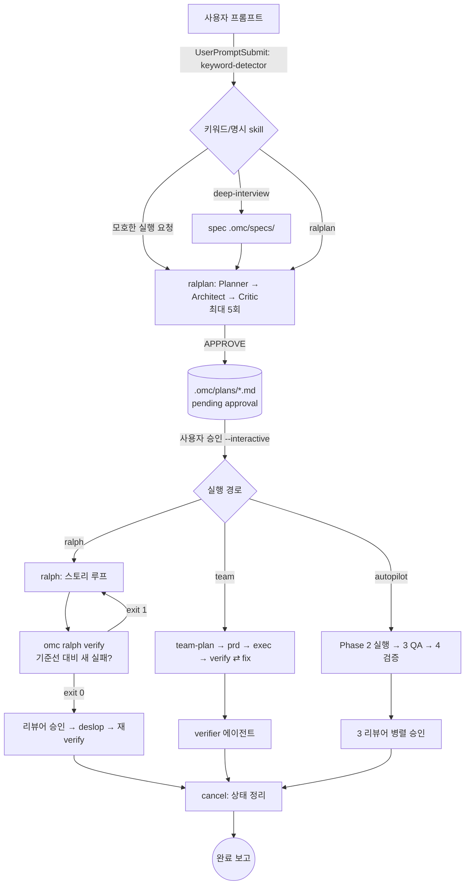
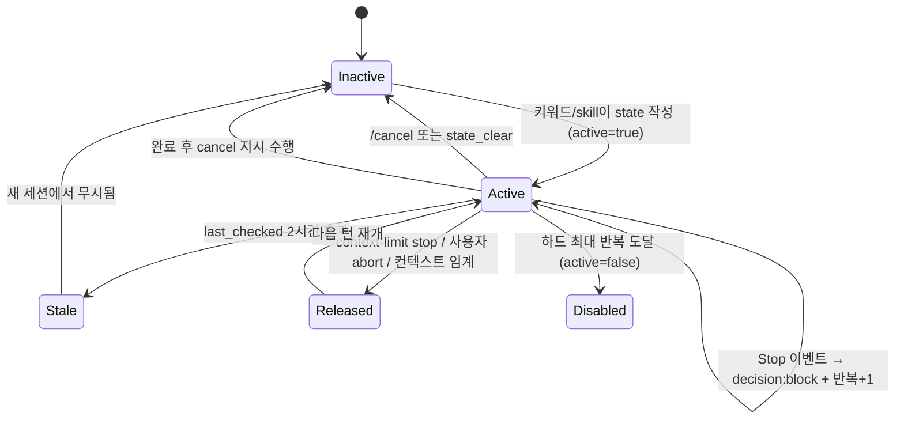

# OMC(oh-my-claudecode) 조사: Red/Green 증거 파이프라인을 얹을 지점과 제약

- 조사 대상: 로컬 설치본 `oh-my-claudecode` v5.7.5 (`~/.claude/plugins/installed_plugins.json`, commit `6688a30`). 이하 `$OMC` = `~/.claude/plugins/cache/omc/oh-my-claudecode/5.7.5`.
- 요약 1: OMC는 "계획 → 실행 → 검증"을 skill 프롬프트와 Stop hook의 지속 루프로 돌리며, 상태는 `.omc/state/` JSON에 둔다. 빌드·배포·CI는 직접 하지 않는다.
- 요약 2: `tdd` skill은 34줄짜리 프롬프트 규칙이다. Red/Green 로그를 파일로 저장하거나 검증하는 코드는 OMC에 없다 (`$OMC/skills/tdd/SKILL.md:30-34`).
- 요약 3: 유일한 테스트 실행 코드 `omc ralph verify`는 "기준선 대비 새 실패 시그니처 유무"만 판정한다. 원문 로그도, Red→Green 전이도 남기지 않는다 (`$OMC/src/hooks/ralph/feedback-baseline.ts:37-70`).
- 요약 4: `git commit`을 막는 OMC hook은 없다 (`$OMC/scripts/git-guardrails.mjs:14-19`). "Red 기록 없이 구현 커밋 금지"는 사용자가 PreToolUse hook으로 직접 만들어야 하며, 그 확장점 자체는 Claude Code 기능이다.
- 요약 5: 증거 파이프라인의 강제력은 OMC가 아니라 프로젝트 소유 hook과 CI가 가져야 한다. 상세는 마지막 절.

표기: 근거는 `경로:줄번호`. "추론"은 코드에서 직접 읽지 않은 해석. "확인 불가"는 근거를 못 찾은 항목.

---

## 1. 전체 실행 파이프라인과 상태 전이

### 1.1 모드와 skill 관계

| 이름 | 성격 | 핵심 동작 | 근거 |
| --- | --- | --- | --- |
| `deep-interview` | 요구 명확화 | 소크라테스식 인터뷰, 모호도 게이트, spec을 `.omc/specs/deep-interview-*.md`에 저장 | `$OMC/skills/autopilot/SKILL.md:86`, `:243-255` |
| `plan` / `ralplan` | 계획 (읽기 전용 경계) | `ralplan` = `plan --consensus`. Planner → Architect → Critic 루프(최대 5회), 결과를 `.omc/plans/`에 `pending approval`로 저장하고 멈춤 | `$OMC/skills/ralplan/SKILL.md:10`, `:56-63`; `$OMC/skills/plan/SKILL.md:153` |
| `execute` | 정본 실행 워크플로 | `autopilot`, `ralph`, `ultragoal`, `ultrapilot`, `pipeline`, `swarm`이 여기로 라우팅. 완료 조건: 대기 작업 없음, 테스트 통과 또는 실패 보고, 검증 증거 수집 | `$OMC/skills/execute/SKILL.md:10-11`, `:42-46` |
| `autopilot` | 아이디어 → 코드 전 과정 | Phase 0 확장 → 1 계획 → 2 실행 → 3 QA(빌드·린트·테스트, 최대 5사이클) → 4 검증(Architect·Security·Code 리뷰어 전원 승인) → 5 정리 | `$OMC/skills/autopilot/SKILL.md:82-121` |
| `ralph` | PRD 기반 지속 루프 | `prd.json`의 스토리가 모두 `passes: true` + 리뷰어 승인될 때까지 반복. 기준선 대비 피드백 게이트 | `$OMC/skills/ralph/SKILL.md:116-189` |
| `team` | 병렬 다중 에이전트 | `team-plan → team-prd → team-exec → team-verify → team-fix` 루프. 실험 플래그 `CLAUDE_CODE_EXPERIMENTAL_AGENT_TEAMS=1` 필요 | `$OMC/skills/team/SKILL.md:11`, `:99`, `:144-151` |
| `ultragoal` | 여러 세션에 걸친 목표 원장 | `.omc/ultragoal/`에 계획·원장 저장. Claude Code 네이티브 `/goal`을 셸에서 못 건드리므로 안내문만 출력 | `$OMC/skills/ultragoal/SKILL.md:8-10`, `:92-96` |
| `tdd` | 규율 skill (모드 아님) | 시임에서 테스트 1개 → 구현 1개 반복. 상태 파일 없음 | `$OMC/skills/tdd/SKILL.md:10-16` |
| `verify` | 규율 skill (모드 아님) | 기존 테스트 → 타입체크/빌드 → 좁은 명령 → 수동 검증 순으로 증거를 보고 | `$OMC/skills/verify/SKILL.md:20-36` |
| `cancel` | 종료·정리 | 현재 세션 범위로 모드 해제. `--all`만 교차 세션 | `$OMC/skills/cancel/SKILL.md:19-35` |

관계 요약
- 진입 관문: 모호한 `ralph`/`autopilot`/`team` 요청은 `ralplan`으로 되돌려진다. 파일 경로, 이슈 번호, 심볼, 테스트 명령, 번호 목록, 수락 기준 중 하나라도 있으면 통과. `force:` 또는 `!` 접두어로 우회 (`$OMC/skills/ralplan/SKILL.md:71-117`).
- 권장 3단계: `deep-interview → ralplan → autopilot`. `.omc/plans/ralplan-*.md`가 있으면 autopilot은 Phase 0·1을 건너뛰고 Phase 2부터 (`$OMC/skills/autopilot/SKILL.md:85`, `:257-273`).
- `ralplan` 승인 후 실행은 `team`(권장) 또는 `ralph`로만 넘어간다. "직접 구현 금지" (`$OMC/skills/ralplan/SKILL.md:63-65`).
- `tdd`는 키워드(`tdd`, `test first`, `red green`)로 UserPromptSubmit 시 메시지가 주입되며(`$OMC/scripts/keyword-detector.mjs:1884-1891`, `:153-158`), 실제 규율은 `Skill("tdd")` 호출로 로드된다.

### 1.2 plan → execute → verify 흐름



주의: ralplan은 `--interactive`가 없으면 승인 대기 상태로 출력만 하고 멈춘다 (`$OMC/skills/ralplan/SKILL.md:20`, `:63`).

### 1.3 모드별 진입/종료/취소 조건

| 모드 | 진입 | 종료(정상) | 종료(비정상/취소) | 근거 |
| --- | --- | --- | --- | --- |
| `ralplan` | 키워드 `ralplan` 또는 게이트 리다이렉트 | Critic APPROVE → `pending approval` 출력 | 5회 반복 후 미승인이면 최선안 제시 | `ralplan/SKILL.md:56-63` |
| `ralph` | 키워드 `ralph`; `prd.json` 스캐폴드 자동 생성 | 전 스토리 `passes:true` + 리뷰어 승인 + deslop + 재verify exit 0 → `cancel` | 반복 한도(기본 100) 도달 시 +10 확장, 하드 한도 도달 시 비활성화. 상태 2시간 경과 시 stale로 무시 | `ralph/SKILL.md:116-189`; `scripts/persistent-mode.mjs:1402-1500`, `:503-507` |
| `autopilot` | 키워드, `--workflow <name>` | Phase 5에서 상태 삭제 후 `cancel` | 동일 QA 오류 3회 반복 시 중단·보고, 검증 3회 거절 시 중단 | `autopilot/SKILL.md:116-121`, `:153-159` |
| `team` | 명시적 `/team`만 (자동 감지 제거됨) | verify 통과 + 잔여 fix 없음 → `complete` | `team-fix` 시도 초과 시 `failed`; 종료 상태는 `complete`/`failed`/`cancelled` | `scripts/keyword-detector.mjs:1868-1870`; `team/SKILL.md:144-151`, `:194-200` |
| `ultragoal` | 키워드 `ultragoal` 또는 `omc ultragoal create-goals` | 최종 스토리에 `--quality-gate-json`(slop/verification/codeReview 모두 clean) | 리뷰 미통과 시 `record-review-blockers`로 블로커 스토리 추가 | `ultragoal/SKILL.md:66-83` |
| 공통 취소 | `cancelomc`, `stopomc`, `/cancel` | - | 키워드 우선순위 1순위 | `keyword-detector.mjs:6-7`, `:1644-1646` |

### 1.4 Stop hook이 만드는 "지속" 상태 전이



근거: block 반복 `scripts/persistent-mode.mjs:1426-1465`; context-limit 비차단 `:1283-1288`; abort 존중 `:1296-1300`; stale `:503-507`, `:1391`; 하드 한도 `:1405-1423`.

### 1.5 상태 저장 위치와 형식

| 대상 | 위치 | 형식 | 근거 |
| --- | --- | --- | --- |
| 모드 상태 | `.omc/state/<mode>-state.json`, 세션별은 `.omc/state/sessions/<sessionId>/<mode>-state.json` | JSON (`active`, `iteration`, `max_iterations`, `session_id`, `current_phase` 등) | `$OMC/src/lib/mode-names.ts:49-57`; `docs/REFERENCE.md:482` |
| ralph PRD | `.omc/state/sessions/<id>/prd.json` | JSON (stories, `passes`, `feedbackCommands`, `criterionAmendments`) | `ralph/SKILL.md:51`, `:79`, `:82-104` |
| ralph 기준선 | `.omc/state/sessions/<id>/feedback-baseline.json` | 명령별 정규화된 실패 시그니처 목록 | `ralph/SKILL.md:128`; `feedback-baseline.ts:20`, `:73-76` |
| ralph 진행/학습 | `progress.txt`, `.omc/notepads/ralph/{problems,issues}.md` | 텍스트 append | `ralph/SKILL.md:126`, `:184` |
| 계획 | `.omc/plans/`, 초안 `.omc/drafts/`, spec `.omc/specs/` | Markdown | `plan/SKILL.md:153` |
| ultragoal | `.omc/ultragoal/{brief.md,goals.json,ledger.jsonl}`, 병렬은 `plans/{planId}/` | JSON, append-only JSONL | `$OMC/src/ultragoal/artifacts.ts:13-24` |
| team | `.omc/state/team/<team>/...`, 단계 전이 `.omc/handoffs/` | JSON/MD | `team/SKILL.md:194-196`; `REFERENCE.md:484` |
| 프로젝트 메모리/노트패드 | `.omc/project-memory.json`, `.omc/notepad.md` | JSON / MD | `REFERENCE.md:487` |
| 접근 도구 | MCP 서버 `t`의 `state_read/write/clear/list_active/get_status`, `notepad_*`, `project_memory_*`, `wiki_*`, `shared_memory_*`, `trace_*` | MCP | `$OMC/.mcp.json`; 도구 목록은 세션의 deferred tool 이름 |
| 상태 루트 결정 | `OMC_STATE_DIR` > `.omc-workspace` 마커 > git > cwd | - | `$OMC/src/lib/worktree-paths.ts:30`; `ultragoal/SKILL.md:100` |

`.omc/` 상태 파일은 위 기본 규칙상 프로젝트 안에 쌓인다. 커밋 대상에서 제외할지는 사용자 결정이다 (`.gitignore` 자동 처리 여부는 확인 불가).

---

## 2. 테스트·빌드·배포가 어디서 어떻게 트리거되는가

### 2.1 OMC가 하는 일 / 하지 않는 일

| 영역 | OMC가 하는 것 | OMC가 하지 않는 것 |
| --- | --- | --- |
| 테스트 | (a) LLM이 Bash로 실행하도록 skill이 지시. (b) `omc ralph verify`가 `feedbackCommands`(없으면 `package.json`의 `build`, `typecheck`, `lint`, `test`, `test:run` 스크립트)를 `spawnSync`로 실행, 타임아웃 600초 | 프레임워크(Vitest 등) 직접 통합, 커버리지 계산, 결과 리포트 생성, 로그 보관. 시그니처만 저장 |
| 빌드 | 위 `feedbackCommands`에 build 포함 시 실행. autopilot Phase 3은 "build, lint, test, fix failures"를 지시 | 번들러 설정·산출물 관리 |
| 배포 | 없음. `release` skill은 저장소의 릴리스 규칙을 `.omc/RELEASE_RULE.md`에 캐시하고 안내하는 어시스턴트 (스킬 설명 기준; 내부 코드는 읽지 않음) | Vercel/GitHub Actions 연동 (확인 불가: 해당 연동 코드를 찾지 못함) |
| CI | CI에서 OMC 상호작용 skill 사용 금지를 명시 (`REFERENCE.md:721-728`) | CI 파이프라인 정의·실행 |
| git | 파괴적 명령 차단(`push`, `reset --hard`, `clean -f`, `branch -D`, `checkout/restore .`), 무인 모드(ralph/autopilot/team/ultragoal) 활성 시 기본 ON. `pr` skill이 PR 본문 초안 작성, 명시 허가 시에만 draft PR | `commit` 차단·검사 없음, push/PR 자동 생성 없음 (autopilot/ralph도 "완료만으로 push·PR 금지") |

근거: `scripts/git-guardrails.mjs:1-38`, `:529-565`; `src/cli/commands/ralph.ts:340-355`, `:361-368`; `autopilot/SKILL.md:116-117`; `ralph/SKILL.md:182`.

### 2.2 트리거 표

| 트리거 | 발생 지점 | 실행되는 것 | 근거 |
| --- | --- | --- | --- |
| UserPromptSubmit | `hooks/hooks.json:4-19` | `keyword-detector.mjs`(키워드 → skill/모드 상태 활성화·메시지 주입), `skill-injector.mjs`(학습 skill 주입) | `keyword-detector.mjs:6-18`, `:2095-2120` |
| SessionStart | `hooks.json:21-71` | `session-start`, `project-memory-session`, `wiki-session-start`, `stale-run-reporter`, `runs-reconciler`. `init`/`maintenance` 매처에서 setup | 같은 파일 |
| PreToolUse `*` | `hooks.json:73-81` | `pre-tool-enforcer.mjs`: skill↔agent 이름 혼동 차단, 모델 라우팅 검증, ultragoal의 `/goal` 가드, 읽기 예산(큰 파일 전체 Read 차단), 에이전트 과다 프리플라이트, 선택적 force-delegation(기본 OFF) | `pre-tool-enforcer.mjs:392-427`, `:1816`, `:1986-2035` |
| PreToolUse `Bash` | `hooks.json:82-93` | `git-guardrails.mjs`: 위 파괴적 git만 exit 2 | `git-guardrails.mjs:14-19`, `:577-578` |
| PermissionRequest `Bash` | `hooks.json:95-105` | `permission-handler`(dist 구현) | `scripts/permission-handler.mjs:12` |
| PostToolUse `*` | `hooks.json:107-124` | `post-tool-verifier.mjs`: Bash 실패 감지 시 "조사하라"는 **조언 메시지**만 주입, 테스트 결과 기록 없음 | `post-tool-verifier.mjs:1001-1008` |
| PostToolUse `Read\|Write\|Edit` | `hooks.json:125-138` | rules-injector(`.claude/rules`, `.github/instructions`, `.cursor/rules` 주입), directory-context | `post-tool-rules-injector.mjs:3-6` |
| SubagentStop | `hooks.json:164-179` | `subagent-tracker`, `verify-deliverables`(**조언만**, 항상 `continue:true`; 팀 단계별 산출물 파일 확인) | `verify-deliverables.mjs:1-20`; `templates/deliverables.json` |
| PreCompact | `hooks.json:181-201` | 상태·메모리·위키 보존 | 같은 파일 |
| Stop | `hooks.json:203-233` | `context-guard-stop`, `workflow-drift-guard`, `persistent-mode`, `budget-guard`, `code-simplifier` | 같은 파일 |
| Stop: drift guard | 위 | 완료 주장 문구가 있고 변경 코드에 `.skip`/`.only`/TODO 스텁이 있으면 `decision:block` | `workflow-drift-guard.mjs:20-27`, `:178-199`, `:923-926` |
| Stop: persistent-mode | 위 | 활성 모드면 `decision:block`으로 계속 작업 지시 | `persistent-mode.mjs:1402-1465` |
| SessionEnd | `hooks.json:235-253` | `session-end`, `wiki-session-end` (async) | 같은 파일 |
| `omc ralph verify` | ralph skill Step 1f/4/7.6 (LLM이 Bash로 호출) | `feedbackCommands` 실행 → 시그니처 diff → exit 0/1 | `ralph/SKILL.md:17-20`, `:128`, `:142`, `:178`; `ralph.ts:361-368` |
| `omc ralph afk` | 사용자 CLI | 헤드리스 ralph 세션을 spawn, 허용 Bash를 `omc ralph verify`와 선언된 `--verify` 명령으로 제한 | `ralph.ts:63`, `:125-172` |
| 테스트 실행 자체 | skill 문구 (`tdd`, `verify`, autopilot Phase 3) | **LLM이 Bash 도구로 실행**. hook이 자동 실행하지 않음 | `tdd/SKILL.md:14`; `verify/SKILL.md:15-17` |

핵심: OMC의 hook 중 **테스트를 실행하거나 결과를 저장하는 hook은 없다**. 실행은 LLM의 Bash 호출이거나 `omc ralph verify` 하나뿐이다. (`vitest`/`npm test` 문자열을 hook 코드에서 검색했을 때 의미 있는 실행 로직은 발견되지 않음. `scripts/risk-assess.mjs`는 파일 분류에 설정 파일명으로 쓸 뿐.)

### 2.3 `omc ralph verify`의 증거 가치

- 입력: PRD `feedbackCommands`, 없으면 `package.json` 스크립트 (`ralph.ts:340-355`).
- 처리: 출력에서 ANSI·시간·tmp 경로·해시를 정규화하고, 통과 건수 요약·`ok N` 행은 **버린다**, 실패 행(`not ok`, `fail`, `error`)만 시그니처로 남긴다 (`feedback-baseline.ts:47-70`).
- 판정: 기준선에 없던 시그니처가 있으면 exit 1, 없으면 exit 0. 기준선이 없으면 현재 시그니처를 후보로만 보고하고 exit 0 (`ralph.ts:190-191`).
- 함의(추론): 이 도구는 "기준선 이후 회귀가 없다"를 판단하지 "이 테스트가 먼저 실패했고 이후 통과했다"를 입증하지 않는다. 또 Vitest 출력이 위 정규화 규칙(TAP 가정)에 맞게 시그니처를 만드는지는 실제 실행 전에는 확인 불가.

---

## 3. 사용자가 확장할 수 있는 지점

### 3.1 확장점 목록

| 확장점 | 위치 | 형식 | 로딩 시점 | 우선순위/충돌 | 최소 예시 | 근거 |
| --- | --- | --- | --- | --- | --- | --- |
| 프로젝트 지침 | `./.claude/CLAUDE.md`, 저장소 `CLAUDE.md`/`AGENTS.md` | Markdown | 세션 시작 (Claude Code 로딩) | 프로젝트 > 전역 (OMC 문서 기준) | `## TDD\n구현 전 docs/evidence/ 에 red 로그 필수` | `REFERENCE.md:119-125`, `:419-431` |
| 커스텀 skill (프로젝트) | `.omc/skills/<name>/SKILL.md` | YAML frontmatter(`name`, `description`, `triggers`, `argument-hint`) + 본문 | UserPromptSubmit 시 `skill-injector`가 트리거 매칭으로 주입 | 사용자 `~/.claude/skills/omc-learned/`, 전역 `~/.omc/skills`, 프로젝트 `.omc/skills` 세 곳을 스캔. 충돌 시 우선순위는 확인 불가 | frontmatter에 `triggers: [red-evidence]` | `skills/skill/SKILL.md:15-24`, `:59-72`; `skill-injector.mjs:636-638` |
| 플러그인 skill 이름 호출 | `/oh-my-claudecode:<name>` | - | 명시 호출 | 번들 skill은 편집·삭제 불가 | `/oh-my-claudecode:tdd` | `skill/SKILL.md:46` |
| 커스텀 agent | `~/.claude/agents/*.md` | frontmatter(`name`, `description`, `tools`, `model`) + 시스템 프롬프트 | 에이전트 스폰 시 | 번들 agent와 같은 이름이면 덮어쓰는 구조로 문서화됨 (정확한 병합 규칙은 확인 불가) | `tools: Read, Bash` `model: sonnet` | `REFERENCE.md:401-417` |
| 규칙 파일 | `.claude/rules`, `.github/instructions`, `.cursor/rules`, `~/.claude/rules` | Markdown | 해당 경로 파일을 Read/Write/Edit할 때 PostToolUse에서 주입 (세션당 중복 제거) | 프로젝트 루트는 접근한 파일 경로에서 산정 | `.claude/rules/tests.md` | `post-tool-rules-injector.mjs:3-14` |
| 설정 파일 | `.claude/omc.jsonc`(프로젝트), `~/.config/claude-omc/config.jsonc`(사용자) | JSONC | 모드 시작 시 | 프로젝트가 사용자를 덮어씀 (`companyContext`, autopilot 프로필은 이름 단위로 통째 교체) | `{"autopilot":{"maxQaCycles":5}}` | `ralplan/SKILL.md:44`; `autopilot/SKILL.md:71`, `:180-195` |
| 라우팅/위임 강제 | `.omc/config.json`의 `routing.forceDelegation.enforce` | JSON | PreToolUse | 기본 OFF | - | `pre-tool-enforcer.mjs:1986-1990` |
| 산출물 요건 | `.omc/deliverables.json` | JSON (`files`, `minSize`, `requiredSections`, `requiredPatterns`) | SubagentStop | 프로젝트 > 플러그인 기본 | 단계별 `QA_REPORT.md` 요구 | `verify-deliverables.mjs:46-68` |
| 환경변수 | `settings.json`의 `env` 등 | - | 프로세스 시작 | `OMC_GIT_GUARDRAILS=0/1`, `DISABLE_OMC`, `OMC_SKIP_HOOKS`, `OMC_STATE_DIR`, `OMC_RUN_BUDGET_TOKENS` | `OMC_STATE_DIR=$HOME/.claude/omc` | `git-guardrails.mjs:9-12`; `REFERENCE.md:131`, `:142-145` |
| 프로젝트 메모리/노트패드 | `.omc/project-memory.json`, `.omc/notepad.md`, MCP `project_memory_*`, `notepad_*` | JSON/MD | SessionStart·PreCompact 주입 | notepad priority/working/manual 구분 | MCP `project_memory_add_directive` | `REFERENCE.md:487`; `hooks.json:21-37` |
| 위키 | `wiki_*` MCP, `wiki` skill | MD | SessionStart/End | - | `wiki_add` | `hooks.json:36-40`, `:235-253` |
| ralph PRD | `feedbackCommands`, `reconciliation.observableChecks`, `repoQualityClass` | JSON | ralph 시작 | PRD가 package script 감지보다 우선 | `"feedbackCommands":["npm run typecheck","npx vitest run"]` | `ralph/SKILL.md:77-79`, `:59-73` |
| 프로젝트 소유 hook | `.claude/settings.json`의 `hooks` | Claude Code 표준 | 이벤트 시점 | OMC 플러그인 hook과 병행 실행(추론: Claude Code 공통 동작) | 아래 3.2 | 아래 3.2 |

### 3.2 "Red 기록 없이 구현 커밋 금지"를 강제할 수 있는 지점 평가

결론: OMC 내부 확장점만으로는 **강제 불가**. 강제하려면 Claude Code 표준 hook을 프로젝트가 직접 추가해야 한다.

| 후보 | 강제 가능? | 방식 | 한계 | 근거 |
| --- | --- | --- | --- | --- |
| OMC `git-guardrails` | 아니오 | 차단 대상에 `commit`이 없음. 규칙 목록이 하드코딩 | 확장 포인트가 없다(설정으로 패턴 추가 불가, 코드 수정은 플러그인 캐시 변경이라 업데이트 시 소실) | `git-guardrails.mjs:29-36`, `:540-581` |
| OMC `workflow-drift-guard` (Stop) | 부분 | 완료 주장 시 `.skip`/`.only`/TODO 스텁 감지 | Red 기록 존재 여부는 보지 않음. 응답 문구 정규식 의존 | `workflow-drift-guard.mjs:18-27`, `:923-926` |
| OMC `verify-deliverables` (SubagentStop) | 아니오 | 산출물 파일 존재 검사 가능 | 항상 비차단·advisory | `verify-deliverables.mjs:5-13` |
| OMC `tdd` / `verify` skill | 아니오 | 프롬프트 규칙 | LLM이 따르지 않아도 막을 수 없음 | `tdd/SKILL.md:30-34` |
| 프로젝트 PreToolUse(Bash) hook | **가능** | `git commit` 명령 감지 → `docs/evidence/`에 해당 변경에 대응하는 red 기록 있는지 검사 → 없으면 exit 2 (git-guardrails가 쓰는 것과 같은 방식) | 우회 가능성: `git commit`을 `sh -c`, 별칭, 다른 도구(IDE, `git -C`)로 호출. 사용자 터미널의 직접 커밋은 막지 못함 | 방식 근거: `git-guardrails.mjs:577-578` (stderr + exit 2). Claude Code hook 규격: https://code.claude.com/docs/en/hooks (`workflow-drift-guard.mjs:5-6`이 인용) |
| Git `pre-commit`/`commit-msg` hook | **가능, 가장 강함** | 에이전트·사람 모두에 적용. 커밋 직전에 증거 파일 검증 | `--no-verify` 우회. 로컬이라 CI 재검증 필요 | 추론 (Git 표준 기능, OMC 무관) |
| CI(GitHub Actions) 검증 | **가능, 최종 방어선** | PR에서 커밋 순서(테스트 커밋 → 구현 커밋)와 증거 해시 검증 | OMC 밖. 증거가 로컬 생성이면 위조 가능성은 남음 | 추론 |
| PostToolUse(Bash) 프로젝트 hook | 기록용 | `vitest` 실행을 감지해 exit code와 원문 출력을 자동으로 `docs/evidence/`에 기록 | LLM이 우회 실행(다른 명령 형태)하면 누락 | 추론. OMC 자체 PostToolUse는 기록하지 않음(`post-tool-verifier.mjs:1001-1008`) |

주의 1: 무인 모드에서 `OMC_GIT_GUARDRAILS=0`이면 가드가 꺼진다 (`git-guardrails.mjs:9-12`). 프로젝트 hook은 OMC 환경변수와 무관하게 동작하므로 독립적이다.
주의 2: 사용자 전역 `~/.claude/CLAUDE.md`가 OMC 블록으로 덮어써질 수 있다. 기본 설정 시 "explicitly overwrites existing `~/.claude/CLAUDE.md`" (`REFERENCE.md:86`). 이미 사용자는 `~/.claude/CLAUDE.md`에서 `~/.codex/AGENTS.md`를 import하는 구성이므로 `claudeMdEnabled: false`(`REFERENCE.md:93-96`) 또는 `--local` 설치를 권장한다. 현재 설치본이 이미 전역 CLAUDE.md를 변경했는지는 이번 조사 범위 밖(확인 불가).

최소 예시(설계 스케치, 이번 조사에서 실행·검증하지 않음)
```jsonc
// <project>/.claude/settings.json  (추론: Claude Code 표준 hook 스키마)
{ "hooks": { "PreToolUse": [ { "matcher": "Bash",
  "hooks": [ { "type": "command", "command": "node .claude/hooks/require-red.mjs" } ] } ] } }
// require-red.mjs: stdin JSON의 tool_input.command가 git commit이고
// staged에 src/ 변경이 있는데 docs/evidence/ 에 짝이 없으면 stderr 출력 후 exit 2
```

---

## 4. 한계와 제약

### 4.1 강제력의 층위

| 층 | 예 | 강제력 |
| --- | --- | --- |
| 프롬프트 규칙 | `tdd`, `verify`, `execute`의 "Do not say complete without evidence" | 약함. 따를지는 LLM 재량 (`verify/SKILL.md:26-30`) |
| 프롬프트 주입 hook | keyword-detector의 TDD 메시지 ("when practical") | 약함. 문구 자체가 느슨 (`keyword-detector.mjs:153-158`) |
| 조언 hook | post-tool-verifier, verify-deliverables | 비차단 |
| 차단 hook | git-guardrails(exit 2), pre-tool-enforcer(deny), persistent-mode/drift-guard(Stop block) | 강함. 단 범위가 좁고 하드코딩 |
| 사용자 소유 hook / git hook / CI | 위 3.2 | 설계 가능 |

### 4.2 항목별 한계

| 항목 | 내용 | 근거 |
| --- | --- | --- |
| 상태 유실 | ralph/상태는 2시간 stale 처리, 비정상 종료 시 stale PRD 경고. `OMC_STATE_DIR`를 안 쓰면 worktree 삭제 시 `.omc/` 소실 | `persistent-mode.mjs:503-507`; `REFERENCE.md:174-194` |
| 지속 루프 해제 | context-limit stop, 사용자 abort, 컨텍스트 임계치에서는 블록하지 않음 → 증거 없이 세션이 끝날 수 있음 | `persistent-mode.mjs:1283-1300` |
| 반복 제한 | ralph는 한도 도달 시 +10씩 자동 확장 (하드 한도는 별도 환경 설정). 무한 비용 방지는 `OMC_RUN_BUDGET_TOKENS`뿐이고 "advisory — 모델이 도구 출력을 읽는 방식" | `persistent-mode.mjs:1469-1493`; `REFERENCE.md:145` |
| 동시성 | 상태는 세션 격리. 같은 워크스페이스에서 ultragoal 동시 실행은 `--plan-id` 없으면 서로 덮어씀. autopilot은 세션 ID가 달라야 함 | `ultragoal/SKILL.md:45-52`, `:98-103`; `autopilot/SKILL.md:170-175` |
| 모드 간 충돌 | autopilot/autoresearch 상호 배타. 네이티브 `/goal`과 ralph는 경쟁 루프이므로 `refuse`/`adopt_existing`/`artifact_only` 정책 중 택일. ultragoal은 실제 `/goal`이 없으면 PreToolUse가 도구 호출을 막음 | `mode-registry/index.ts:94`; `ralph/SKILL.md:38`, `:113`; `ultragoal/SKILL.md:60-62` |
| 토큰·비용 | ralplan은 Planner/Architect/Critic를 최대 5회, autopilot은 Opus 역할 다수, team은 N 워커. 규모가 작으면 오버스펙. execute 스킬도 "작업에 맞는 기계를 쓰라" 명시 | `ralplan/SKILL.md:56-61`; `autopilot/SKILL.md:89-100`; `execute/SKILL.md:23-30` |
| 플랫폼/버전 | 지금 환경은 Linux/WSL2로 요건 충족. `team`은 `CLAUDE_CODE_EXPERIMENTAL_AGENT_TEAMS=1` 필요, Claude Code 2.1.178+ 의존. 명명 autopilot 프로필은 Linux + `flock` 필요. 서브에이전트 중첩 깊이는 Claude Code 버전(2.1.217-218 기본 1, 2.1.219+ 기본 3)에 따라 다름 | `team/SKILL.md:11`; `autopilot/SKILL.md:45`, `:127` |
| 문서-코드 차이 | 공식 README는 TDD를 언급하지 않고 verify를 "tests/build/lint/typecheck 목표가 통과할 때까지 완료 점검"으로 설명 (https://github.com/Yeachan-Heo/oh-my-claudecode). 로컬 코드의 `tdd` skill은 존재하며 시임 합의형. 일반 hooks 문서는 `docs/HOOKS.md`가 "21 hooks"라 하나 `hooks.json`의 이벤트 구성과 숫자가 일치하는지는 확인 불가. 충돌 시 로컬 코드 기준 | `docs/HOOKS.md:3-7`; `hooks.json` |
| 재현성 | LLM 판단이 단계마다 개입(리뷰어 승인, 시임 선택, 스토리 분해). 같은 입력의 같은 결과를 보장하는 코드는 없음. 플러그인 버전이 올라가면 hook·skill 문구가 바뀜 (설치 시각 2026-10-20, v5.7.5 고정 필요) | `installed_plugins.json` |

### 4.3 TDD 증거 입증 관점에서 신뢰도가 약해지는 지점

1. 증거 부재: `tdd`의 "Red/green evidence — the failing run and the passing run"은 출력 요구일 뿐, 저장 위치·형식·검증이 없다 (`tdd/SKILL.md:32-34`).
2. 자기 보고: ralph의 `passes: true`는 LLM이 쓴다. 리뷰어도 LLM 에이전트다 (`ralph/SKILL.md:146-149`, `:156-167`).
3. `omc ralph verify`는 통과 로그를 버리고, 기준선에 이미 있는 실패는 "환경 소음"으로 허용한다. Red 상태로 기준선을 만들면 Red가 그대로 정상으로 취급될 수 있다 (`ralph/SKILL.md:128`; `feedback-baseline.ts:47-70`). (추론)
4. 순서 입증 불가: Red 로그가 구현 *이전*임을 증명하는 타임스탬프·커밋 순서 장치가 OMC에 없다. 
5. 기준 완화 경로: ralph는 증거 기반으로 수락 기준을 `replaced`/`superseded`로 바꿀 수 있다 (감사 기록은 남음) (`ralph/SKILL.md:82-104`).
6. 방지 장치가 표면적: drift guard는 `.skip`/TODO만 보며 응답 문구 정규식에 의존한다 (`workflow-drift-guard.mjs:18-27`).
7. 조작 용이성: `.omc/state`와 `docs/evidence`는 에이전트가 쓸 수 있는 평문 파일이다. 서명·해시 연쇄는 OMC에 없다 (확인 불가: 해당 기능 코드 미발견).
8. `.omc/`는 세션 상태이므로 증거의 정본으로 삼으면 안 된다. 정본은 커밋되는 `docs/evidence/`로 두고, OMC 상태는 보조로 쓴다.

---

## fm-showcase 하네스 설계 시사점

### OMC가 이미 해주는 것

- `ralplan` 합의 계획: Planner/Architect/Critic 루프, 승인 전 쓰기 금지 경계, 계획 파일(`.omc/plans/`) (`ralplan/SKILL.md:33-35`).
- 모호한 실행 요청 차단 게이트 (`ralplan/SKILL.md:71-117`).
- `tdd` 규율 텍스트: 독립된 기대값, 한 번에 테스트 1개, 시임 합의, "테스트가 이유 있게 실패하는지 확인" (`tdd/SKILL.md:12-24`).
- 지속 루프와 취소: Stop hook 기반 계속 작업, `cancel` 정리 (`persistent-mode.mjs:1402-1465`).
- 회귀 판정: `omc ralph verify`의 기준선 diff (`ralph.ts:177-191`).
- 위험 git 명령 차단, `.skip`/`.only`/TODO 완료 차단 (`git-guardrails.mjs:14-19`; `workflow-drift-guard.mjs:20-27`).
- 상태 영속화 MCP 도구와 notepad/project-memory.

### 직접 만들어야 하는 것

1. 증거 기록기: Vitest 실행(Red/Green)의 명령, exit code, 원문 출력, 시각, 대상 테스트 파일 해시를 `docs/evidence/`에 저장하는 래퍼 스크립트(예: `npm run evidence:red`). OMC에는 없다.
2. 순서 증명: 테스트 커밋 → Red 기록 → 구현 커밋 → Green 기록 순서를 커밋 해시와 연결하는 규칙.
3. 차단 장치: 프로젝트 `.claude/settings.json` PreToolUse(Bash) hook + Git `pre-commit`로 "Red 기록 없는 구현 커밋" 차단. 그리고 CI(GitHub Actions)에서 같은 검증을 재실행.
4. 증거 검증기: 증거 파일 형식·짝(테스트 ↔ 구현 커밋)·Red가 실제로 실패였는지(exit code ≠ 0, 기대한 실패 메시지)를 확인하는 스크립트.
5. `feedbackCommands` 정의: ralph를 쓴다면 PRD에 `npx vitest run` 등을 명시하고, 기준선 정책(Red를 기준선으로 삼지 않기)을 결정.
6. 빌드·배포·CI: 전부 OMC 밖. Vite 빌드, Vercel 배포, Actions 워크플로.
7. OMC 버전 고정과 전역 CLAUDE.md 보호 정책.

### 가장 위험한 가정 3개

1. 가정: "`tdd` skill과 `ralph verify`를 쓰면 Red/Green 기록이 남는다." 
   현실: 둘 다 로그를 저장하지 않는다. `ralph verify`는 통과 줄을 버리고 실패 시그니처만 남기며, `tdd`는 출력을 요구만 한다 (`feedback-baseline.ts:47-70`; `tdd/SKILL.md:30-34`). 증거는 전부 직접 만들어야 한다.
2. 가정: "OMC hook으로 '증거 없는 구현 커밋 금지'를 걸 수 있다."
   현실: 커밋을 보는 OMC hook은 없고 `git-guardrails`는 확장 불가·하드코딩이다 (`git-guardrails.mjs:29-36`). 프로젝트 hook과 git hook, CI로 강제해야 하고, 그래도 `--no-verify`·직접 커밋은 로컬에서 막을 수 없어 CI가 최종 방어선이다.
3. 가정: "OMC의 완료 선언과 상태 파일이 과정 준수의 증거다."
   현실: `passes: true`, 리뷰어 승인, `.omc/state`는 모두 LLM이 쓰는 평문이고, 2시간 stale·context-limit·abort 시 해제되며, 세션 상태이지 감사 기록이 아니다 (`persistent-mode.mjs:503-507`, `:1283-1300`). 신뢰 근거는 커밋된 증거 파일과 CI 결과여야 한다.

---

## 확인 불가 항목 정리

- Vitest 출력이 `signatureLines`(TAP 가정 정규화)로 의미 있는 시그니처를 만드는지: 실제 실행 필요.
- `.omc/` 자동 `.gitignore` 처리 여부.
- 커스텀 skill이 세 위치(`~/.claude/skills/omc-learned`, `~/.omc/skills`, `.omc/skills`)에서 충돌할 때의 우선순위.
- 커스텀 agent가 번들 agent와 같은 이름일 때의 정확한 병합 규칙.
- `release` skill 본문과 GitHub Actions/Vercel 연동 코드 (읽지 않음, 연동 코드는 검색에서 발견되지 않음).
- `docs/HOOKS.md`의 "21 hooks"와 `hooks.json` 구성의 정확한 대응.
- 상태 서명·해시 연쇄 등 변조 방지 기능 (코드에서 발견되지 않음).
- 현재 설치가 사용자 전역 `~/.claude/CLAUDE.md`를 이미 변경했는지 (사용자 홈 파일은 이번 조사에서 확인 대상 아님).
- 프로젝트 `.claude/settings.json` hook이 OMC 플러그인 hook과 병행 실행되는 세부 순서 (Claude Code 규격 기반 추론).
